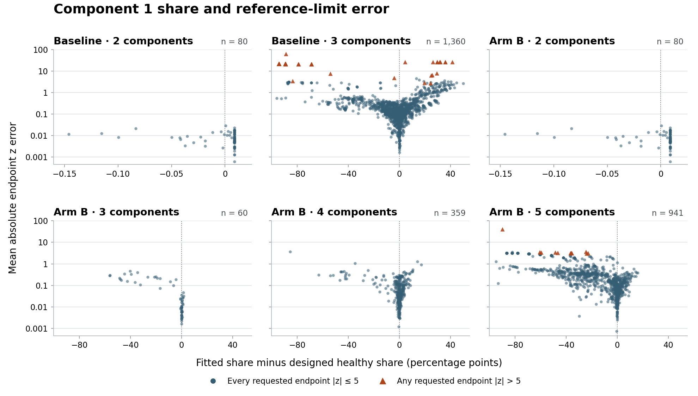

# Component 1’s routine share in the archived 50,000-result fits

Arm B selected five components on 941 of 1,440 RIbench datasets. On those datasets, component 1 accounted for **49.85%** of routine results on average, compared with a **69.17%** physiological share in the generating design. The average shortfall was **19.32 percentage points**. Larger absolute gaps were associated with larger endpoint errors in this group (Spearman ρ = 0.786). The association persisted within each of the eight designed pathological fractions, with correlations from 0.527 to 0.894. [Results within pathological fractions](by-components-and-fraction.csv)

The signed gap is fitted component-1 routine share minus the designed physiological share, in percentage points. RIbench assigns 0.1% to uniform background, so the physiological share is 100% minus the pathological percentage minus 0.1%. Endpoint error is the uncapped mean of the absolute endpoint z deviations before the safeguard. CRP contributes its 95th-percentile upper limit alone. All 1,440 paired datasets had scorable raw limits for both methods. This includes 305 first-stage declines for Arm B and 374 for the improved Task E baseline.

| Method | Selected components | Datasets | Mean fitted / true share (%) | Mean signed gap (pp) | Mean absolute gap (pp) | Mean endpoint error | ρ signed / absolute gap vs. error |
| --- | ---: | ---: | ---: | ---: | ---: | ---: | ---: |
| Arm B | 2 | 80 | 99.897 / 99.900 | −0.003 | 0.016 | 0.009 | −0.219 / −0.057 |
| Arm B | 3 | 60 | 87.15 / 98.15 | −11.00 | 11.32 | 0.087 | −0.617 / 0.838 |
| Arm B | 4 | 359 | 70.48 / 72.95 | −2.47 | 4.50 | 0.113 | 0.014 / 0.621 |
| Arm B | 5 | 941 | 49.85 / 69.17 | −19.32 | 20.92 | 0.567 | −0.692 / 0.786 |
| **Arm B** | **All** | **1,440** | **59.33 / 73.03** | **−13.70** | **15.26** | **0.403** | **−0.602 / 0.834** |
| Baseline | 2 | 80 | 99.897 / 99.900 | −0.003 | 0.016 | 0.009 | −0.219 / −0.057 |
| Baseline | 3 | 1,360 | 66.56 / 71.44 | −4.88 | 14.49 | 0.979 | −0.017 / 0.754 |
| **Baseline** | **All** | **1,440** | **68.41 / 73.03** | **−4.61** | **13.69** | **0.925** | **−0.030 / 0.792** |

Both methods selected two components on the same 80 datasets, all at 0% designed pathology. One-component fits would assign 100% to component 1. Neither method selected one. The selected groups differ in their true shares, so differences between rows also reflect which datasets selected each component count. The median signed gap for five-component Arm B was −11.99 points (interquartile range −32.20 to −0.21). For the three-component baseline it was −1.13 points (−9.44 to +4.98). [Medians, interquartile ranges and correlations for every group](by-components.csv)



Each point represents one fit. The vertical axis is logarithmic. The two-component panels magnify the horizontal axis because their greatest absolute gap was 0.15 percentage points.

**Extreme endpoints.** Arm B had 11 datasets with at least one endpoint |z| > 5. All 11 selected five components and underestimated the healthy share by at least 20 points (11 of 420 fits with an absolute gap that large). The baseline had 41 extreme datasets. Of those, 38 had an absolute gap of at least 20 points (38 of 316). Thus absolute gap tracked error within each method, but across the same 1,440 datasets Arm B had the larger average absolute gap and fewer extreme endpoints. The true share used to calculate this gap is known from the simulation design. [Counts and error by gap size](gap-bands.csv) · [Endpoint errors and safeguard status for each fit](fits.csv)

**Verification.** Reconstructing the physiological, pathological and background counts reproduced all 1,440 observed routine lengths. Substituting the realized healthy fraction for the design fraction changed any dataset’s signed gap by at most 0.0019 percentage points. An independent calculation checked every field in the 2,880 fit rows and all 130 summary rows. The greatest absolute summary difference was 1.42 × 10⁻¹⁴. A fresh run reproduced the six data and provenance files byte for byte. [Count reconciliation](count-discrepancies.csv)

## Reproduce the analysis

The script reads the archived fits and scores at `amromeo.github.io@8bcd49c` and the design and input hashes at `anchorRefine@638e2d3`. From the site repository root, with the second checkout in `../anchorRefine`, run the following commands. The figure requires Matplotlib. [Independent verification](verification.json) · [Source revisions and file hashes](sources.json) · [Original Task E report](https://github.com/amromeo/amromeo.github.io/blob/8bcd49c3c7977c50982524b9dbc48d16bdfa5914/anchoredRI/tools/boxcox/accuracy/large/results/REPORT.md)

```sh
python3 anchoredRI/tools/subsample/archived-shares.py --anchorrefine-repo ../anchorRefine
python3 anchoredRI/tools/subsample/plot-archived-shares.py
```
